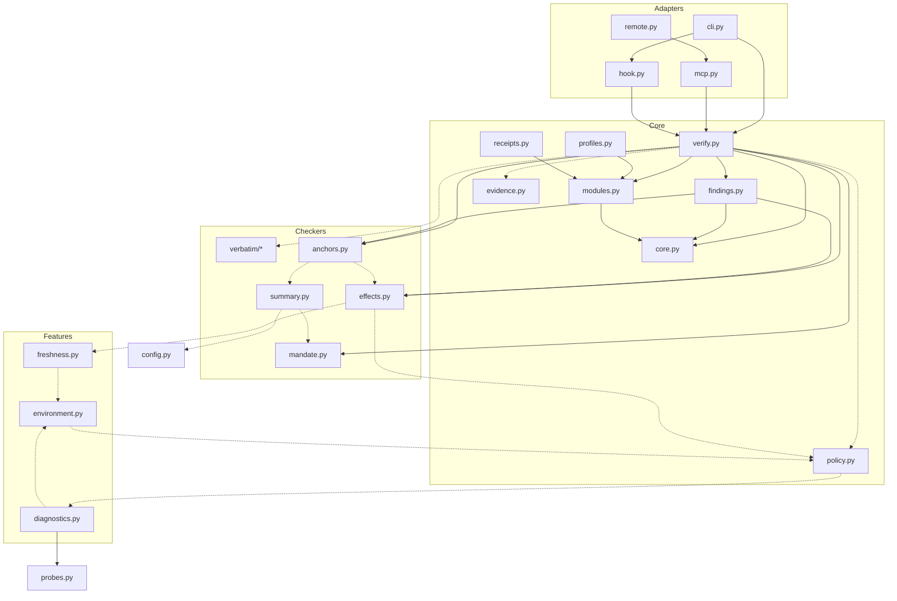

# Buddie — Architecture Boundary Audit

Дата: 2026-10-26. Предмет: фактическая архитектура Buddie 2.0.1 и её готовность к модульности.
Связанные документы: [MODULAR_ARCHITECTURE_PROPOSAL.md](MODULAR_ARCHITECTURE_PROPOSAL.md),
[MODULARIZATION_ROADMAP.md](MODULARIZATION_ROADMAP.md), [PILOT_MODULE_PLAN.md](PILOT_MODULE_PLAN.md).

Метки утверждений:

- **[O] Observed** — подтверждено кодом (путь, символ, строки) или выполненным экспериментом/тестом.
- **[I] Inferred** — вывод из наблюдений; прямой проверки не было.
- **[P] Proposed** — предложение; в коде этого нет.

Номера строк относятся к коммиту `0bc048e` (`main`).

---

## 0. Сводка

1. **[O]** Гипотеза Core / Modules / Adapters уже **частично реализована как логический модульный монолит**:
   есть ядро типизированных контрактов (`buddie/core.py`), декларативный реестр модулей проверки
   (`buddie/modules.py`: `sources`, `github`, `execution`), профили (`buddie/profiles.py`), двухверсионный
   Receipt Contract (`buddie/receipts.py`), тонкие транспорты (`cli.py`, `mcp.py`, `remote.py`, `hook.py`), а также тест,
   запрещающий общим частям импортировать адаптеры (`tests/test_layers.py::test_no_shared_part_imports_an_adapter`).
2. **[O]** Реестр модулей — это **метаданные, а не механизм вызова**. Диспетчеризация зашита в
   `verify._assess` (`buddie/verify.py:194-313`) и `anchors.check_one` (`buddie/anchors.py:224-268`). Модуль — это
   набор `core.Check`, а не единица кода: модули `github` и `execution` делят файлы `effects.py` и `anchors.py`.
3. **[O]** Направленные проблемные зависимости:
   - проверка `choice:` неявно читает журнал хука на машине (эксперимент E1);
   - `policy.py` зависит от `diagnostics.py`, поэтому проверки через `policy.current()` транзитивно зависят от
     диагностики окружения;
   - хук читает внутренности receipt-v0 как внутренний API и сопоставляет строки `blocking` с findings по позиции.
4. **[O]** На уровне модуля (top-level) граф импортов **ацикличен**. С учётом 187 импортов внутри функций
   образуется сильно связная компонента из 15 модулей. Код работает, потому что импорты ленивые, но изоляции нет:
   если убрать один компонент, падает вся проверка, а не только его часть (E2).
5. **[O]** Отказ одного компонента сейчас **fail-closed**: возникает исключение, а не ложный PASS. Но результаты
   других проверок при этом теряются: инвариант «ошибка одного модуля не подменяет результаты других» соблюдается
   только в слабой форме (E2).
6. **[O]** Наиболее независимые части: `buddie/verbatim/` (5 модулей при реальном вызове, свой CLI и своя версия),
   `environment.py` (только `runner`), ядро контрактов (`core`, `modules`, `profiles`, `receipts` не зависят ни от
   одного checker'а).
7. Рекомендация (подробно в §14): **сначала ограниченные архитектурные изменения**, затем один пилот (`sources`) внутри
   того же пакета. Разделять пакеты сейчас не нужно.

---

## 1. Проверенное состояние репозитория

| Что | Значение | Как проверено |
|---|---|---|
| `main` HEAD | `0bc048e7439ac283409fdfd05f763a506a95888a` («docs: add mcpservers.org badge and catalog status (#53)») | `git fetch origin && git rev-parse origin/main` |
| Релиз | `v2.0.1` → `6266e873827970fc0d4174811993bad6d5a13a97`, опубликован 2026-10-25T21:13:23Z | `gh release view v2.0.1`, `git rev-parse v2.0.1^{commit}` |
| Код после релиза | в `buddie/` изменений нет; в `tests/` изменён только `tests/test_readme.py` (+4/−2) | `git diff --stat 6266e87 0bc048e -- buddie tests` |
| Версия | `2.0.1` в `pyproject.toml` и `buddie/__init__.py:3` | чтение файлов |
| CI на `main` | последние 5 push-запусков `ci` — success (например, run `40253608829` для `0bc048e`, 4m17s) | `gh run list --branch main --limit 5` |
| Runtime-зависимости | нет (`dependencies = []`); опционально `playwright` (extra `browser`) | `pyproject.toml` |
| Пакеты | `buddie`, `buddie.verbatim`; entry points `buddie`, `buddie-verbatim` | `pyproject.toml [tool.setuptools]`, `[project.scripts]` |
| Объём | 13 728 строк в `buddie/` (44 файла), 47 тестовых файлов импортируют `buddie` | `wc -l`, `grep -l` |

Аудит выполнен в ветке `docs/architecture-audit`, созданной от `origin/main`. В `main` ничего не менялось.

**Локальный прогон тестов.** 1353 passed, 53 skipped (§12, приложение A). Среда: Windows 11, Python 3.14.6. Матрица CI: Ubuntu 3.11/3.12/3.13, плюс
macOS/Windows на 3.11, `.github/workflows/ci.yml`. Версия 3.14 в CI не входит, поэтому локальный результат — дополнительный
сигнал, а не замена CI.

---

## 2. Карта компонентов

Классификация: **Core** — общие контракты и оркестрация; **Module** — функциональная возможность проверки;
**Lib** — общая вспомогательная библиотека; **Adapter** — интерфейс взаимодействия; **Feature** — самостоятельная
возможность, не являющаяся проверкой отчёта.

| Компонент | Файлы (строк) | Роль по коду | Класс |
|---|---|---|---|
| Контракт проверок | `core.py` (198) | `Check`, `Fact`, `Sufficiency`, `Decision`, `Outcome`, `ReasonCode`, `Provenance`, `EvidenceRef`, `Finding`, `Coverage`, `Policy`, `outcome()`, `v0_outcome()`; только stdlib | Core |
| Реестр модулей | `modules.py` (98) | `Module(id, checks, inputs, summary)`, `REGISTRY`, `select`, `results`, `UnknownModule` | Core |
| Профили | `profiles.py` (154) | `Selection`, `resolve`, `effective`, `from_config`, `gate_levels` | Core |
| Перевод вердиктов | `findings.py` (181) | таблицы `QUOTE_FACTS`/`NUMBER_FACTS`/`STATUS_FACTS`, `anchor_check`, `github_provenance`, `coverage` | Core (знает и checker'ы, и ядро) |
| Оркестратор | `verify.py` (381) | `verify`, `assess`, `assess_selected`, `assessment`, `Assessment`, `_assess` | Core (с зашитой логикой модулей) |
| Receipt Contract | `receipts.py` (343) + `docs/receipt-v1.schema.json` | `render`, `v1`, `SCHEMA`, `problems`, `line` | Core |
| Цитаты и числа | `verbatim/` (2516): `report`, `check`, `numbers`, `store`, `textlayer`, `access`, `cli` | извлечение цитат, сравнение с байтами снапшота, хранилище | Module `sources` |
| Якоря репозитория | `anchors.py` (323) | разбор `⚓`, `path#sha`, `path@commit`, `fact=`, диспетчер всех якорей, `unanchored` | Module `github` + диспетчер |
| Эффекты | `effects.py` (386) | `pr:`, `ci:` (GitHub REST), `run:` (транскрипт), детектор «работа в прозе», `github_get`, `api()` | Modules `github` и `execution` в одном файле |
| Очередь работ | `mandate.py` (632), `patterns.py` (281) | work claims против `buddie.toml [mandate]`; regex в изолированном процессе | Module `execution` |
| Выбор пользователя | `summary.py` (490), `decisions.py` (260) | `check_choice` по журналу/транскрипту; сводка субагентов | Module `execution` + Feature хука |
| Хранилища снапшотов | `stores.py` (178) | `UnionStore`, `session_stores` | Lib (sources) |
| Источники доказательств | `evidence.py` (188) | выбор репо и хранилищ, `Origin`, `network_clean`, изолированный collector | Core (trust) |
| Процессы | `runner.py` (305) | ограниченный subprocess, «закалённый» git | Lib |
| Защищённая политика | `policy.py` (320), `winacl.py` (221) | `/etc/buddie/policy.toml` / ProgramData, `current()`, `held()` | Core (trust boundary) |
| Конфигурация гейта | `config.py` (384), `resolved.py` (167), `event.py`, `context.py` | уровни классов гейта, источники настроек | Adapter-support (хук) |
| Журнал | `logbook.py`, `journal.py`, `suggest.py`, `promises.py` | журнал хука, уроки, подсказки якорей, обещания | Feature хука |
| Окружение | `environment.py` (511) | снапшот runtime/repo/artifacts | Feature |
| Диагностика | `diagnostics.py` (773), `probes.py` (829) | категории машины по грантам; **собственный** реестр `Module` | Feature |
| Свежесть | `freshness.py` (413) | CURRENT/STALE/UNKNOWN; `ci_evidence` используется в `ci:` | Feature + Lib для `github` |
| CLI | `cli.py` (618) | 17 подкоманд | Adapter |
| MCP stdio | `mcp.py` (341) | 5 инструментов | Adapter |
| MCP HTTP | `remote.py` (392) | 3 инструмента, без файловых аргументов | Adapter |
| Claude Code / Codex hook | `hook.py` (644), `hooks/`, `integrations/codex/` | гейт перед ответом | Adapter |
| Упаковки клиентов | `.claude-plugin/`, `.codex-plugin/`, `integrations/chatgpt/`, `manifest.json` (mcpb), `server.json`, `Dockerfile`, `render.yaml`, `skills/`, `commands/` | декларации для каталогов и клиентов | Adapter (без кода) |

---

## 3. Граф зависимостей

### 3.1 Как получен

**[O]** AST-скрипт обошёл все `import`/`from … import` в `buddie/**/*.py` и разделил импорты на уровень модуля и уровень
функции. Скрипт лежит вне репозитория, в scratchpad сессии; его вывод воспроизводится любым AST-обходом. Итог:

- 48 импортов `buddie.*` на уровне модуля, 187 — внутри функций;
- **граф уровня модуля ацикличен** (DFS-поиск циклов дал пустой результат);
- с учётом ленивых импортов есть одна сильно связная компонента (SCC) из 15 модулей:
  `anchors, config, decisions, diagnostics, effects, environment, event, evidence, freshness, logbook, mandate,
  policy, probes, stores, summary`.

### 3.2 Ключевые рёбра (упрощённо)

Сплошная линия — импорт на уровне модуля, пунктир — внутри функции.

### 3.3 Транзитивное замыкание (статически, с ленивыми импортами)

| Точка входа | Модулей `buddie.*` в замыкании |
|---|---|
| `core` | 0 |
| `modules`, `receipts` | 1–2 (`core`, `modules`) |
| `profiles` | 2 |
| `verbatim.check` | 4 (`runner`, `verbatim.access/store/textlayer`) |
| `findings`, `anchors`, `effects`, `mandate`, `environment`, `freshness`, `diagnostics` | 23 |
| `verify` | 30 |

### 3.4 Фактически загружаемое при вызове (эксперимент E3)

| Вызов | Загружено `buddie.*` |
|---|---|
| `verbatim.check_claims(...)` | 5: `verbatim`, `verbatim.check/report/store/textlayer` |
| `import core, modules, profiles, receipts` | 4 |
| `verify.verify(...)` с одним file-якорем | 19 (в т.ч. `mandate`, `patterns`, `effects`, `stores`, `policy`, весь `verbatim`) |
| `import environment` | 2 (`environment`, `runner`) |
| `import freshness` | 2 (`core`, `freshness`) |
| `mcp.handle(tools/list)` | 1 (`mcp`) |

**[I]** Статическое замыкание сильно завышает реальную связанность: большинство рёбер SCC проходит через ленивые
импорты в редких ветках. Но эти ветки и есть скрытые зависимости, которые сломаются при разделении.

---

## 4. Поток проверки и формирование вердиктов

**[O]** `verify.assessment` (`verify.py:172-191`) → `profiles.resolve` → `policy.held()` (одно чтение защищённой
политики на всю проверку) → `_assess` (`verify.py:194-313`):

1. Выбор: `selection.checks` или все `Check` (`verify.py:212-219`).
2. Хранилище: `Store`/`UnionStore`. Чтобы знать, что именно эта проверка получила сама, фиксируется `store.collected`
   до и после (`verify.py:220-225, 240`).
3. Checker'ы вызываются **напрямую и последовательно**: `check_quotes` (verbatim), `anc.check_text` (все якоря, фильтр
   `keep` по выбранным модулям), `eff.prose_work`, `anc.unanchored`, `man.check_text`, `check_numbers`
   (`verify.py:226-238`).
4. Строки checker'ов переводятся в `core.Finding` через `fnd.from_rows` (`verify.py:241-242`). Provenance задаёт
   **оркестратор**, а не checker: `observed` вычисляется по идентичности класса хранилища и чистоте сети, а
   `github_collected` — по идентичности GET-функции (`effects.own_get`).
5. `core.v0_outcome` — слово receipt-v0 (`verify.py:243`).
6. Coverage (`fnd.coverage`) — что не проверено и почему.
7. **Receipt-v0 собирается из сырых строк checker'ов, а не из findings**: строки `blocking`/`gaps` формируются по
   словам вердиктов каждого checker'а (`verify.py:249-266`), `summary` — подсчёт слов (`verify.py:276-282`).
8. `executed`/`not_run`/`detected` для receipt-v1 (`verify.py:296-313`).

Семантика вердиктов **[O]**:
- слово checker'а переводится в `Fact` по исчерпывающим таблицам (`findings.py:15-19`); незнакомое слово даёт
  `UNRECOGNIZED`, которое никогда не считается поддержкой;
- `Policy.decide` (`core.py:158-169`): CONTRADICTED → BLOCK (для `NUMBER` — только при `block_numbers`),
  UNDETERMINED/UNRECOGNIZED → FLAG;
- `core.outcome` (`core.py:172-183`): ничего не проверено → UNKNOWN; выключенная capability → GAPS, а не PASS;
- receipt-v1: NOT_RUN/EMPTY/PASS/GAPS/UNKNOWN/FAIL и `scope.coverage` FULL/PARTIAL/UNKNOWN/NONE (`receipts.py:96-110`).

**[O]** Политики на трёх уровнях, и это разные механизмы:
1. `core.Policy` — что блокирует finding (сейчас один флаг `block_numbers`);
2. уровни классов гейта `config.py` (`anchors`, `quotes`, `final`, `prose`, `numbers`, `work`, `summary`,
   `promises`, `context`: block/warn/off) — только для хука;
3. защищённая политика `policy.py` — полы и потолки, которые агент не может изменить (файл root/SYSTEM).

---

## 5. Публичные контракты и их стабильность

| Контракт | Где определён | Кто потребляет | Стабильность |
|---|---|---|---|
| receipt-v0 (in-toto Statement, `…#receipt-v0`) | `verify._assess` (`verify.py:267-295`) | внешние оркестраторы, CLI `--json`, MCP по умолчанию, remote, **хук, журнал, summary** | Высокая: по умолчанию везде; ключи `predicate` используют внутренние модули (§7, C5) |
| receipt-v1 | `receipts.v1`, `receipts.SCHEMA`, `docs/receipt-v1.schema.json` | CLI/MCP по запросу | Высокая: схема в файле сверяется тестом (`tests/test_receipts.py::test_the_schema_file_is_the_schema`), `problems()` проверяет внутреннюю согласованность |
| Python API | `verify.verify`, `verify.assessment`, `receipts.render` (`docs/integrations.md:34`) | интеграторы | Средняя: задокументирован, но `__all__` нет; сигнатуры с 13–16 keyword-аргументами |
| CLI | `cli.main` (17 подкоманд), коды выхода | пользователи, CI-примеры (`.github/workflows/ci.yml`) | Высокая: проверяется в CI |
| MCP stdio | `mcp.TOOLS` (5 инструментов), `INSTRUCTIONS` | Claude Code, Codex, Desktop | Высокая: проверяются `tests/test_mcp_stdio.py`, `tests/test_instructions.py` |
| MCP HTTP | `remote.HANDLERS` (3 инструмента), `_DROP` | ChatGPT, claude.ai | Высокая: CI `docker` проверяет `tools/list` и SSRF |
| Идентификаторы модулей | `modules.IDS = ("sources","github","execution")` | CLI `--modules`, MCP `modules`, `buddie.toml [verify]` | Высокая: зафиксированы тестом (`tests/test_modules.py::test_the_ids_are_stable_…`) |
| Значения `core.Check` | `core.py:30-41` | receipt-v1 `check`, `[verify] checks`, MCP `checks` | Высокая (публичные строки) |
| Профили | `profiles.NAMES` | CLI/MCP/конфиг | Высокая |
| `buddie.toml`, `policy.toml`, `environment.toml` | `config.py`, `policy.py`, `diagnostics.py` | пользователи, администраторы | Высокая |
| `environment-diagnostics-v1`, снапшот окружения, freshness | `diagnostics.py`, `environment.py`, `freshness.py` | CLI `snapshot`/`freshness`, MCP `environment_snapshot` | Средняя: отдельные документы, не receipts |
| Решения гейта | `tests/data/gate_golden.json` (819 сценариев) | хук | Высокая (golden) |
| Внутренние строки checker'ов (`dict` с `verdict`/`status`) | каждый checker | `findings.py`, `verify.py`, **хук** | Низкая: неформальные, без типов |

---

## 6. Ввод-вывод: файловая система, сеть, subprocess

| Компонент | ФС | Сеть | Subprocess |
|---|---|---|---|
| `verbatim.store` | чтение и запись хранилища снапшотов | HTTP(S) fetch | — |
| `verbatim.textlayer`, `verbatim.access` | временные файлы | (browser: Chromium) | `pdftotext` через `runner`; playwright |
| `anchors` | чтение файлов репо (защита от symlink/hardlink/выхода за корень, `anchors.py:122-204`) | — | `git cat-file`, `git rev-parse` через `runner.git` |
| `effects` | транскрипт `.jsonl` | GitHub REST (`effects.github_get`, `effects.py:131-182`) | — |
| `mandate`, `patterns` | очередь и сообщения из репо | — | worker `python -I` для regex из конфигурации репо |
| `summary.check_choice` | **журнал хука** (`~/.cache/buddie/hook.jsonl` или `BUDDIE_LOG`) и общий каталог | — | — |
| `policy`, `winacl` | системный файл политики, ACL | — | — |
| `environment`, `diagnostics`, `probes` | фиксированные файлы ОС, гранты | — | фиксированные программы через `runner` |
| `logbook`, `journal` | журнал (запись и чтение) | — | — |
| `remote` | — | HTTP-сервер; fetch только на публичные адреса | — |

**[O]** Весь subprocess идёт через `runner.run`/`runner.git`: таймаут, лимит вывода, без shell, очищенное окружение
(`runner.py`, docstring). Это уже общая библиотека с чёткой границей.

---

## 7. Точки сильной связанности

### C1. Реестр модулей описывает, но не вызывает **[O]**
`modules.Module` содержит только `id`, `checks`, `inputs`, `summary` (`modules.py:33-47`). Как вызывать модуль,
реестр не знает: `_assess` вызывает каждый checker по имени и для каждого держит свою логику (`verify.py:226-266`).
Новый модуль потребует правок в `verify._assess`, `findings.py` (таблицы, `anchor_check`, `ANCHOR_EVIDENCE`),
`verify._detected`, `verify._excluded`, `verify.line`, `receipts`, а для хука — ещё в `config.CLASS_OF_CHECK` и
`profiles.CLASS_CHECKS`.
Это прямо задокументировано: «the checking itself stays where it was» (`modules.py`, docstring).

### C2. Модуль ≠ единица кода **[O]**
- `effects.py` обслуживает `github` (`pr:`, `ci:`) и `execution` (`run:`), а также детектор «работа в прозе»
  (`effects.prose_work`), который не принадлежит ни одному модулю.
- `anchors.check_one` (`anchors.py:224-268`) — общий диспетчер всех якорей: `effects.check` для pr/ci/run,
  `summary.check_choice` для `choice:`, собственная логика для file/commit/fact.
- `findings.anchor_check` (`findings.py:74-90`) определяет вид якоря по регулярным выражениям из двух модулей.

### C3. Скрытый вход: `choice:` читает журнал машины **[O]**
`anchors.check_text` получает контекст только `{"github", "transcript"}` (`verify.py:228`). `summary.check_choice`
берёт `ctx.get("journal")`, получает `None` и читает `logbook.journal_paths()` (`summary.py:438-453, 460-468`), то есть
локальный журнал хука. Вход `journal` модуля `execution` объявлен (`modules.py:46`), но **передать его через
`verify()`/`assessment()` нельзя**.
**Эксперимент E1:** один и тот же текст `⚓ choice:card42=3` с одними и теми же аргументами `verify.verify(...)` даёт
`GAPS/UNCHECKABLE`, если журнала нет, и `PASS/HOLDS`, если в `BUDDIE_LOG` записана строка `choice`.
Provenance этой улики корректно помечена `AGENT_WRITABLE` (`findings.py:100`), так что ложного «наблюдения» нет. Но
результат CLI/MCP-вызова зависит от состояния машины, которого нет в аргументах.

### C4. Политика тянет диагностику окружения **[O]**
`policy.py:196` при разборе `[environment]` импортирует `diagnostics` и вызывает приватную `diagnostics._allow_list`.
`effects.api()` (`effects.py:51-60`) читает `policy.current()`, и каждая `pr:`/`ci:` проверка зависит от
`policy`. Через это ребро ядро доверия (`policy`) связано с необязательной возможностью (`diagnostics` → `probes`,
`environment`). Это главный источник 15-модульной SCC.

### C5. Receipt-v0 как внутренний API **[O]**
Хук, журнал и summary читают поля `predicate` напрямую (`hook.py:110-123, 443, 463-469, 504, 541-543`;
`journal.py:70-88`; `summary.py:141-143`). `hook.gate_items` сопоставляет строки `predicate.blocking` с
`verify.blocking_findings(...)` **по позиции** (`hook.py:534-543`). Если длины расходятся, класс гейта не определяется
(`None`), и гейт блокирует каждый пункт: fail-closed, проверено в
`tests/test_failsafe.py::test_a_mismatch_blocks_every_item_and_is_journaled`. Ложного пропуска нет, но любое изменение
порядка или состава `blocking` в оркестраторе меняет поведение гейта: уровни warn/off для классов перестают работать. Поэтому форма
receipt-v0 фактически заморожена дважды: внешними потребителями и собственным хуком.

### C6. Обязательные импорты необязательных частей **[O]**
- `verify.py:39` импортирует `mandate` на уровне модуля. Без `mandate` не работает даже проверка цитат (E2).
- `effects._ci` импортирует `freshness` **до** проверки режима offline (`effects.py:247-248`). Без `freshness` любой
  `ci:` якорь падает, даже при `github=None` (E2).

### C7. Отказ компонента обрушивает всю проверку **[O]**
E2: если `summary` или `decisions` недоступны, текст из цитаты и `choice:` даёт исключение, и результат цитаты тоже
теряется. Изоляции ошибок по модулям нет: `_assess` не ловит исключения checker'ов. Хук превращает исключение в
возврат ответа (`hook.failed`, `hook.py:598`), то есть fail-closed. Это проверено в
`tests/test_failsafe.py::test_an_error_in_the_check_returns_the_answer_once`. Поведение безопасно, но не изолировано.

### C8. Два разных «Module» **[O]**
`modules.Module` (проверки отчёта) и `diagnostics.Module` (категории окружения, `diagnostics.py:66-77`) — разные
понятия с одним именем. У `diagnostics` уже есть модель состояний (`allowed`/`denied`/`unavailable`/`unsupported` с
причинами, `diagnostics.py:289-294`) и модель разрешений (гранты ∩ потолок политики, `diagnostics.decide`,
`diagnostics.py:246-261`). У модулей проверки такой модели нет.

### C9. Адаптер MCP знает форму результатов **[O]** (мелкое)
`mcp.handle` особым образом обрабатывает имена `verify_report`, `summary`, `environment_snapshot` при сборке текстового
ответа (`mcp.py:303-311`).

---

## 8. Что уже хорошо отделено

- **[O]** `core.py` — только stdlib; не импортирует ни checker, ни транспорт (docstring; `tests/test_core.py`).
- **[O]** Общие части не импортируют адаптеры; хук импортирует только CLI (`tests/test_layers.py:39-47`).
- **[O]** Импорт общих частей не открывает файлов (`tests/test_layers.py::test_importing_the_shared_parts_reads_and_writes_no_file`).
- **[O]** Каждый `Check` принадлежит ровно одному модулю (`tests/test_modules.py`).
- **[O]** Невыбранный модуль даёт `Skip(capability=True)`, поэтому core outcome — GAPS, а не PASS
  (`tests/test_modules.py::test_a_module_left_out_is_not_run_and_coverage_says_so`).
- **[O]** Provenance вычисляет оркестратор по идентичности объектов, а не по полям от checker'а или вызывающего
  (`verify.py:220-225`, `effects.own_get`, `findings.github_provenance`).
- **[O]** `verbatim` — самостоятельный подпакет с собственными CLI, версией и тестами (`tests/quotes/`). Его
  единственная зависимость за пределами подпакета — ленивый `buddie.runner` в `textlayer`.
- **[O]** Remote-сервер сужает поверхность декларативно (`remote._DROP`, `remote.py:216-240`).

---

## 9. Сверка документации с кодом

| Утверждение в `docs/architecture.md` | Результат |
|---|---|
| ядро, модули, checker'ы, `findings`, `verify`, `evidence` не импортируют транспорт | **[O] подтверждено** (`tests/test_layers.py`, граф импортов) |
| каждый Check принадлежит ровно одному модулю | **[O] подтверждено** |
| модуль — фиксированная часть, без загрузки кода | **[O] подтверждено** (`modules.py`) |
| «Freshness … read by no gate» | **[O] уточнение:** документ freshness гейтом не читается, но код `freshness.ci_evidence` выполняется в каждой проверке `ci:` (`effects.py:247`) |
| 819 сценариев гейта | **[O] подтверждено** (`tests/data/gate_golden.json`: 819 ключей) |
| входы модуля — «plain values» | **[O] частично:** вход `journal` модуля `execution` не принимается API, а читается из окружения (C3) |

---

## 10. Архитектурные ограничения

1. **[O]** Модель угроз: агент работает под тем же пользователем ОС, поэтому всё локальное агенту доступно для записи
   (`policy.py`, `evidence.py`, docstrings). Единственная граница доверия, недоступная агенту, — системный файл
   политики. Это определяет, что архитектура может гарантировать (см. PROPOSAL §6).
2. **[O]** Без runtime-зависимостей: любое API модулей должно быть на stdlib.
3. **[O]** receipt-v0 — формат по умолчанию для всех транспортов и для хука (`tests/test_receipts.py::test_the_hook_and_the_journal_stay_on_v0`).
4. **[O]** Хук ограничен по времени (`runner` deadline, таймауты в `hooks/hooks.json`: 60–120 с). Изоляция модулей
   через отдельные процессы стоила бы времени старта.
5. **[I]** Порядок строк в `blocking`/`gaps`/`anchors` — часть контракта (C5), и переставлять вызовы checker'ов нельзя.

---

## 11. Риски и возможные регрессии при модуляризации

| Риск | Где проявится | Чем ловится сейчас |
|---|---|---|
| Изменение порядка или состава `blocking` | классы гейта (`hook.gate_items`) | `tests/data/gate_golden.json`, `tests/test_gate.py`, `tests/test_layers.py` |
| Изменение provenance (например, checker сам ставит COLLECTOR_OBSERVED) | receipt-v1 `evidence`, политика `stores="observed"` | `tests/test_provenance_unforgeable.py`, `tests/test_provenance_boundaries.py` |
| Расхождение v0 и v1 | внешние потребители | `tests/test_receipts.py::test_v0_and_v1_agree_on_the_same_assessment` |
| Потеря `quote_backed`/`unanchored` (межмодульный поток: результат `sources` влияет на сигнал о голых числах) | хук `final`, журнал | `tests/test_buddie.py`, `tests/test_gate.py` (**[I]** покрытие не проверено построчно) |
| Новая ошибка импорта при старте хука | все события хука | CI `os` (smoke через `hooks/run.sh`) |
| Изменение текста `predicate.line` | MCP-ответ, хук | `tests/test_instructions.py`, `tests/test_mcp_stdio.py` |
| Скрытое изменение входа `choice:` (C3) | `choice:` в CLI/MCP | **нет теста на независимость от журнала машины** (E1) |

---

## 12. Практическая верификация

### 12.1 Тесты
Локальный полный прогон: **1353 passed, 53 skipped**, код выхода 0 (приложение A). CI на `0bc048e`: success
(run `40253608829`).

### 12.2 Эксперименты
Скрипты лежат в scratchpad сессии, а не в репозитории. Запуск: `python -I <script> <repo>`; `BUDDIE_LOG` указывает
во временный каталог или отключён (`0`).

**E1 — скрытый журнал.** `verify.verify("… ⚓ `choice:card42=3`", fetch=False, mandate=False)`:

| Состояние журнала | outcome | статус якоря |
|---|---|---|
| нет файла | GAPS | UNCHECKABLE |
| одна строка `{"choice": {"id": "card42", "chosen": ["3"], …}}` | PASS | HOLDS |

**E2 — недоступность компонента.** Импорт модуля блокируется через `MetaPathFinder`, затем `verify.verify` вызывается
на пяти текстах (`fetch=False`, `github=None`, `mandate=False`):

| Заблокирован | quote | file | choice | ci | quote+choice |
|---|---|---|---|---|---|
| `summary` | ok | ok | **CRASH** | ok | **CRASH** (результат цитаты потерян) |
| `decisions` | ok | ok | **CRASH** | ok | **CRASH** |
| `mandate` | **CRASH** | **CRASH** | **CRASH** | **CRASH** | **CRASH** |
| `freshness` | ok | ok | ok | **CRASH** (даже offline) | ok |
| `diagnostics` | ok | ok | ok | ok | ok |
| `environment` | ok | ok | ok | ok | ok |
| `effects`, `stores`, `policy`, `verbatim.numbers` | **CRASH** везде | | | | |

Ни в одном случае отказ не дал PASS: исключение всегда прерывает проверку целиком. Без политики на машине `diagnostics`
и `environment` при `verify` не нужны.

**E3 — что загружается** (§3.4). `verbatim` работает без остального пакета, а `verify` всегда загружает 19 модулей.

### 12.3 Ограничения проверки
- Python 3.14 локально вместо 3.11–3.13; macOS и Linux не запускались (их покрывает CI).
- Сетевые пути (GitHub, fetch) в экспериментах выключены; поведение с сетью принято по коду и тестам.
- Покрытие тестами межмодульного потока `quote_backed` → `unanchored` построчно не измерялось.
- Защищённая политика на машине отсутствует; ветки `policy.py` с `[environment]` (C4) проверены чтением кода, не запуском.

---

## 13. Уверенность в выводах

| Вывод | Уверенность | Основание |
|---|---|---|
| Логический модульный монолит уже есть (core/modules/profiles/receipts/adapters) | высокая | код + тесты слоёв |
| Реестр не диспетчеризует (C1) | высокая | `modules.py`, `verify._assess` |
| Скрытый вход `choice:` (C3) | высокая | E1 |
| Отказ модуля не изолирован (C7) | высокая | E2 |
| `policy` → `diagnostics` — главный источник SCC (C4) | средняя | граф; другие ленивые рёбра (`environment→policy`, `freshness→environment`) тоже участвуют |
| Пилот `sources` выделяется без изменения контрактов | средняя | по коду; не проверено реализацией |
| Независимые пакеты сейчас не окупаются | средняя | [I] из отсутствия зависимостей и размера; данных о пользователях нет |

---

## 14. Итоговая техническая рекомендация

**Сначала ограниченные архитектурные изменения, затем один пилот внутри того же пакета.**

- «Начать выделение модулей» в смысле отдельных пакетов или плагинов — **нет**. У Buddie нет runtime-зависимостей,
  которые нужно изолировать: необязательный `playwright` уже решён через extra. Размер (13,7 тыс. строк) и единый
  цикл релизов не оправдывают матрицу совместимости пакетов. Ядро и так не зависит от checker'ов.
- «Отложить модульность» целиком — тоже **нет**. Аудит нашёл конкретные дефекты границ, которые стоит закрыть
  независимо от модульности: C3 влияет на воспроизводимость receipts, C5 и C7 — на надёжность гейта, C6 — на хрупкость.
  Их исправление дешёвое и не меняет контрактов.
- Пилот (`sources` за явным контрактом checker'а) стоит делать только после этих шагов и только если цель —
  добавлять новые модули проверки. Если новых модулей в планах нет, достаточно шагов 1–4 roadmap.

План работ — в [MODULARIZATION_ROADMAP.md](MODULARIZATION_ROADMAP.md).

---

## 15. Открытые вопросы и непроверенные предположения

1. Должен ли CLI/MCP `verify` вообще читать журнал машины для `choice:`, или `choice:` вне хука должен давать
   UNCHECKABLE без явного `journal`? Это продуктовое решение: техническое исправление C3 возможно в обоих вариантах.
2. Есть ли внешние потребители, которые полагаются на точный текст строк `blocking`/`gaps` receipt-v0? Данных нет.
3. Есть ли планы на новые модули проверки (например, history/lineage)? **[O]** Реализации истории или lineage как
   модуля проверки в коде нет. Есть журнал хука (`journal.py`) и freshness, но это не проверка утверждений отчёта.
4. Насколько тесты покрывают межмодульный поток `quote_backed`/`unanchored`.
5. Поведение на Python 3.14 в CI не проверяется (матрица 3.11–3.13).

---

## Приложение A. Прогон тестов

Команда: `PYTHONUTF8=1 python -m pytest -q -p no:cacheprovider` в ветке `docs/architecture-audit`. Код этой ветки
совпадает с `0bc048e`: добавлены только эти документы.

Результат: **1353 passed, 53 skipped за 273.79 с, код выхода 0** (Windows 11, Python 3.14.6). Причины пропусков не
разбирались; **[I]** скорее всего, это проверки только для POSIX и внешних инструментов.
