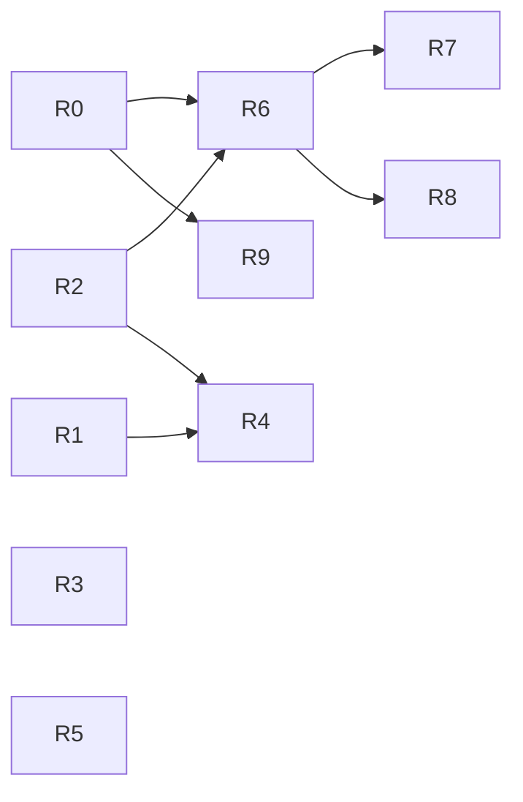

# Buddie — Modularization Roadmap

Основано на [ARCHITECTURE_AUDIT.md](ARCHITECTURE_AUDIT.md) и [MODULAR_ARCHITECTURE_PROPOSAL.md](MODULAR_ARCHITECTURE_PROPOSAL.md).
Каждая задача — отдельный PR от `main`. Сложность оценена грубо: **S** — до ~150 строк и пара файлов; **M** — несколько
файлов и новые тесты; **L** — затрагивает гейт или несколько модулей. Сроков нет намеренно.

Общие правила для всех задач:
- не меняются слова вердиктов, outcome, форма receipt-v0/v1, `tools/list`, коды выхода CLI;
- все существующие тесты проходят **без правок**; разрешено только добавлять тесты;
- новых runtime-зависимостей нет;
- откат — `git revert` одного PR (каждая задача атомарна).

---

## Фаза 0 — страховка

### R0. Golden-корпус receipts · S–M · приоритет 1
**Зачем.** Сейчас нет теста, который сравнивал бы полный receipt-v0/v1 до и после рефакторинга оркестратора на
разнообразных текстах. `gate_golden.json` фиксирует решения гейта, а не JSON receipts.
**Изменения.** `tests/data/receipts_golden.json` и `tests/test_receipts_golden.py`. Корпус — 20–40 текстов: примеры из
`examples/`, цитаты FOUND/NOT_FOUND/SOURCE_UNAVAILABLE/без ссылки, короткие цитаты, числа в режимах gap/fail/off,
строка `quote_backed` со счётчиком, file/commit/fact/pr/ci/run/choice-якоря offline, профили `research`/`developer`/
`custom`, `quotes=False`. Параметры фиксированы: `now`, `fetch=False`, `github=None`, хранилище заполнено через
`Store.add`, `BUDDIE_LOG` во временный файл.
Тест сравнивает `receipts.dumps(render(a, "v0"))` и `"v1"` с эталоном. Опция `--regen` не нужна: эталон пишется
одноразовым скриптом в том же PR.
**Риск.** Нестабильные поля (`checked_at` фиксируется через `now`, `repo` — абсолютный путь). Перед сравнением пути
нормализуются в `<repo>`.
**Приёмка.** Тест зелёный на матрице CI (3 ОС × 3.11–3.13); эталон не зависит от ОС.
**Откат.** Удалить два файла.

---

## Фаза 1 — ограниченные изменения границ (без Module API)

### R1. Явный вход журнала для `choice:` (C3) · S · приоритет 1
**Зачем.** Сейчас результат `verify()` зависит от журнала машины, которого нет в аргументах (эксперимент E1).
**Изменения.** Необязательный kwarg `journal: list[Path] | None = None` в `verify.verify/assess/assess_selected/
assessment`. Он передаётся в контекст `anc.check_text` (`verify.py:228`) как `"journal"`. При `None` вызов
разрешается в `logbook.journal_paths()` **в одном месте** (`verify.assessment`), а не внутри
`summary.check_choice`, так что поведение 2.0.1 сохраняется. CLI, MCP и хук не меняются.
**Тесты.** (a) `journal=[]` → `choice:` всегда UNCHECKABLE, что бы ни лежало в `BUDDIE_LOG`; (b) `journal=None` → как
сейчас (воспроизводит E1); (c) `summary.check_choice` без `journal` в ctx больше не читает файлы (audit hook, как в
`tests/test_layers.py::test_importing_the_shared_parts_reads_and_writes_no_file`).
**Риск.** Хук передаёт свой контекст: нужно проверить, что журнал хука — тот же путь. Ловится `gate_golden.json` и
`tests/test_summary.py`.
**Открытый вопрос (продуктовый).** Должны ли CLI/MCP по умолчанию передавать `journal=[]`? Это изменение поведения:
не делать в R1, решить отдельно.
**Приёмка.** Новые тесты зелёные, R0 без изменений.

### R2. Убрать необязательные зависимости из обязательного пути (C6) · S · приоритет 1
**Изменения.** (a) `effects._ci`: импорт `freshness` перенести после проверки offline (`effects.py:247-248`).
(b) `verify.py:39`: импорт `mandate` из уровня модуля перенести в функции, где он используется (`_assess`, `line`).
**Тесты.** Тест в стиле E2: с заблокированным `buddie.mandate` проверка цитаты отрабатывает при `mandate=False`; с
заблокированным `buddie.freshness` `ci:` при `github=None` даёт UNCHECKABLE.
**Риск.** Минимальный; изменения только в порядке импортов.
**Приёмка.** Новые тесты, R0 и весь набор зелёные.

### R3. Тест-фиксация fail-closed на уровне модуля (инвариант 3) · S · приоритет 2
**Изменения.** Только тест. Исключение в одном checker'е при смешанном тексте (цитата + `choice:`) → `assessment`
выбрасывает исключение, хук возвращает ответ (exit 2), ни CLI, ни MCP не выдают receipt с PASS.
**Зачем.** Будущий рефакторинг не должен «тихо» начать ловить исключения и превращать их в GAPS.
**Приёмка.** Тест зелёный сейчас и после R5.

### R4. Тест границ модулей (декларация полномочий) · S · приоритет 2 · после R1, R2
**Изменения.** `tests/test_module_boundaries.py`: AST-проверка импортов по файлам модулей. Минимальный набор правил:
(a) `buddie/verbatim/**` не импортирует ничего из `buddie.*`, кроме `buddie.verbatim.*` и `buddie.runner`;
(b) checker'ы (`verbatim`, `anchors`, `effects`, `mandate`) не импортируют `logbook`/`journal`/`hook`/`config`;
(c) `summary.check_choice` не вызывает `journal_paths` (после R1).
Правила, которые сейчас нарушаются, записываются как `xfail(strict=True)` со ссылкой на задачу. Известные нарушения:
`mandate.py:175` импортирует `config.read_toml`, `anchors.py:229` — `summary`. Тогда исправление
нарушения обнаружится тестом.
**Приёмка.** Тест зелёный; список исключений явный.

### R5. Разорвать ребро `policy → diagnostics` (C4) · S–M · приоритет 3
**Изменения.** Вынести статические данные категорий (id, tier, `BASELINE`, `expand`, `_allow_list`) в
`buddie/categories.py` (только stdlib, без импортов `buddie`). `diagnostics.py` реэкспортирует их, `policy.py`
импортирует `categories`.
**Тесты.** Транзитивное замыкание импортов `policy` не содержит `diagnostics`/`probes`/`environment`; поведение
разбора `[environment]` не меняется (`tests/test_policy.py`, `tests/test_diagnostics.py`).
**Риск.** `diagnostics.REGISTRY` содержит `Method`-описания: переносить нужно только id и tier, а не коллекторы.
**Приёмка.** SCC из аудита уменьшается (повторный запуск графа в §3 аудита); все тесты зелёные.

**Контрольная точка после фазы 1.** Если в обозримом плане нет **новых модулей проверки**, на этом стоит
остановиться: фазы 0–1 закрывают все найденные дефекты границ. Фазу 2 стоит начинать только при реальной
потребности добавлять модули.

---

## Фаза 2 — минимальный Module API (пилот)

### R6. `Inputs` + `Module.run` для `sources` · M · приоритет 2 · после R0, R2
Подробно — в [PILOT_MODULE_PLAN.md](PILOT_MODULE_PLAN.md).
**Приёмка.** R0 байт-в-байт; все тесты без правок; `verify._assess` вызывает `sources` через реестр.

### R7. Capability states в `buddie modules --json` · S–M · приоритет 3 · после R6
**Изменения.** Для каждого модуля — `{id, checks, inputs, state, reason}`. Состояние вычисляется локально и без сети:
наличие `buddie.toml [mandate]` в репо из `--repo`, наличие `playwright` (`importlib.util.find_spec`), признак
«настроен ли GitHub-токен» (только булево, значение не выводится), статус защищённой политики. Словарь причин — из
receipt-v1 и `diagnostics` (PROPOSAL §5.2), новых слов не вводится.
**Риск.** Утечка значений окружения → тест «вывод не содержит значений переменных» (как
`tests/test_receipts.py::test_a_receipt_carries_no_token_or_environment`).
**Приёмка.** Вывод детерминирован; MCP не меняется.

---

## Фаза 3 — только по необходимости

### R8. `github` и `execution` через `Module.run`; разделить `effects.py` · L · после R6
`pr:`/`ci:` → модуль `github`, `run:` → `execution`. Детектор «работа в прозе» (`effects.prose_work`) переходит в
общие текстовые сигналы Core, рядом с `anchors.unanchored`. Диспетчер `anchors.check_one` остаётся разбором формы, а
проверка уходит в модуль. **Риск высокий:** обработка токена (`github_get`), provenance по идентичности
(`own_get`, `_OWN_GETS`), `freshness.ci_evidence`. Нужны отдельный security-review и
`tests/test_provenance_unforgeable.py` без правок.

### R9. Хук читает findings, а не позиции receipt-v0 (C5) · L · независимо, после R0
Заменить позиционное сопоставление `blocking` ↔ findings (`hook.gate_items`) явной связью: каждый пункт `blocking`
строится из своего finding. Поведение должно совпасть по всем 819 сценариям `gate_golden.json`.

### Не планируется
Отдельные пакеты (вариант B), загрузка сторонних модулей, модули вне процесса, модуль history/lineage, новый
MCP-инструмент discovery. Пересмотреть при появлении модуля с тяжёлой runtime-зависимостью или внешнего автора модулей.

---

## Граф зависимостей задач

| Задача | Фаза | Сложность | Меняет поведение? | Зависит от |
|---|---|---|---|---|
| R0 golden receipts | 0 | S–M | нет | — |
| R1 явный journal | 1 | S | нет (default = 2.0.1) | — |
| R2 ленивые импорты | 1 | S | нет | — |
| R3 тест fail-closed | 1 | S | нет | — |
| R4 тест границ | 1 | S | нет | R1, R2 |
| R5 categories.py | 1 | S–M | нет | — |
| R6 пилот `sources` | 2 | M | нет | R0, R2 |
| R7 `modules --json` | 2 | S–M | аддитивно | R6 |
| R8 github/execution | 3 | L | нет | R6 |
| R9 хук на findings | 3 | L | нет | R0 |
