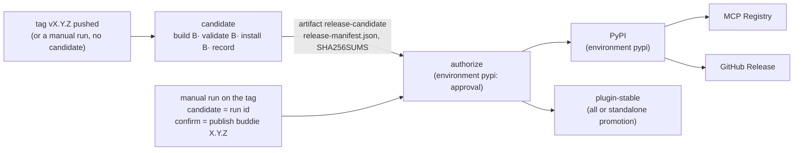

# Releasing buddie

A release is two runs of [`release.yml`](../.github/workflows/release.yml): a **candidate** built and checked from
one commit, then a **publish** run that a person starts on purpose and that sends those same files out. Pushing a
tag publishes nothing.



## 1. The candidate

[`release-candidate.yml`](../.github/workflows/release-candidate.yml) runs for a pushed tag `v*`, for a manual run of
`release.yml` with an empty `candidate`, and for **every pull request** (from `ci.yml`), so the path is exercised
long before a release needs it. With read-only permission and no secret, it:

1. checks that `buddie.__version__`, `server.json`, `manifest.json` and both plugin manifests agree, and that a tag,
   if there is one, is `v` + that version;
2. builds the sdist and the wheel once (`python -m build`), runs `twine check --strict` and checks that the wheel
   carries no top-level module but `buddie`;
3. validates and packs the Claude Desktop bundle (`@anthropic-ai/mcpb@2.1.2`), unpacks it, checks that it carries no
   tests, research, docs, hooks or skills, and starts its server the way Claude Desktop does
   ([`scripts/smoke_mcpb.py`](../scripts/smoke_mcpb.py));
4. installs the wheel and the sdist each into a clean venv and runs them from outside the checkout
   ([`scripts/smoke_install.py`](../scripts/smoke_install.py)): both entry points report the version, the stdio MCP
   server lists its five tools (`environment_snapshot` among them), and the quickstart ([verification.md](verification.md#see-it-work)) gives exit 1 and
   `FAIL`;
5. builds the compact Claude Code plugin from the same commit ([`scripts/plugin_package.py`](../scripts/plugin_package.py),
   [plugin-distribution.md](plugin-distribution.md)). It checks that a rebuild gives the same bytes, validates it
   with the pinned Claude Code CLI (`plugin validate --strict`, also `--profile directory`), installs it into an
   isolated Claude Code configuration, and runs the installed copy
   ([`scripts/smoke_plugin.py`](../scripts/smoke_plugin.py)): exact files, MCP, an optional token, hooks;
6. records the candidate ([`scripts/release_manifest.py`](../scripts/release_manifest.py)): `release-manifest.json`
   (schema `buddie-release-candidate-v1`: version, commit, ref, repository, run id, and each file's path, kind,
   size and SHA-256) and `SHA256SUMS` in the format `sha256sum -c` reads; both are checked against the files at once;
   The record also requires the plugin's own manifest to name this commit, this version and the recorded ZIP;
7. uploads `dist/`, `bundle/`, `plugin/`, the record and the sums as the artifact `release-candidate`, and writes the
   sums and the record into the run's summary.

The same check runs on a machine of your own without GitHub:

```bash
python -m build --outdir rc/dist
```

```bash
npx --yes @anthropic-ai/mcpb@2.1.2 pack . rc/bundle/buddie-2.0.0.mcpb
```

```bash
python scripts/release_manifest.py write rc --version 2.0.0 --commit "$(git rev-parse HEAD)"
```

```bash
cd rc && sha256sum -c SHA256SUMS
```

## 2. Publishing

Only a manual run publishes: Actions в†’ **release** в†’ *Run workflow*, **on the tag** `vX.Y.Z` (not a branch), with

| Input | Value |
|---|---|
| `candidate` | the run id of the candidate run for this tag (the number in its URL) |
| `confirm` | exactly `publish buddie X.Y.Z` |
| `only` | `all` (or one stage again, below) |

or from a terminal:

```bash
gh workflow run release.yml --repo tsyyan/buddie --ref vX.Y.Z -f candidate=RUN_ID -f confirm="publish buddie X.Y.Z"
```

**`authorize`** downloads the candidate and refuses the run unless every one of these holds
([`scripts/release_publish.py`](../scripts/release_publish.py) `authorize`, tested in
[`tests/test_release_publish.py`](../tests/test_release_publish.py)):

- the run is on a tag (not a branch), the tag is `v` + `buddie.__version__`, and the tag names the commit the run
  checked out;
- that commit is in `main`'s history;
- `confirm` is exactly `publish buddie X.Y.Z`;
- the candidate run is a run of `.github/workflows/release.yml` (not CI's), in this repository and built from it, on
  this tag (`head_branch`) and this commit (`head_sha`), triggered by a push or a manual run, `completed` with
  `success`;
- the artifact's own record names that run id, this repository and `refs/tags/vX.Y.Z`, and its files, record and
  sums agree byte for byte.

A typo, a branch, a tag on an unmerged or other commit, a candidate from another commit, workflow or repository, a
failed run, a rebuilt file: each stops here, before anything leaves.

Then each stage downloads the **candidate's artifact** (never a new build) and checks it again:

| Stage | Before | Publishes | How | After | What the check proves |
|---|---|---|---|---|---|
| `pypi` | PyPI's JSON API for the version: absent в†’ upload; exactly the candidate's files в†’ done, no upload; any other file в†’ **stop** | the wheel and the sdist (not the bundle) | trusted publishing from environment `pypi` (GitHub's OIDC token, no PyPI token stored), `skip-existing` | PyPI serves exactly the candidate's two files | **bytes**: PyPI publishes each file's SHA-256 |
| `mcp-registry` | PyPI serves the candidate's files; the registry's entry for the version, if any, must name the same server, version, repository and PyPI package as `server.json`, else **stop** | `server.json` as `io.github.tsyyan/buddie` | `mcp-publisher` v1.8.1, its download checked against its release's SHA-256; GitHub OIDC proves the namespace | the entry matches `server.json` | **metadata only**: the registry stores no digest. It points clients at `buddie==X.Y.Z` on PyPI, whose bytes the `pypi` check covers |
| `github-release` | PyPI serves the candidate's files; the tag names the candidate's commit | a release with the CHANGELOG section, the three files, `release-manifest.json` and `SHA256SUMS` | finds the published release by tag, else the one draft for the tag, else creates a draft; re-reads it by id; uploads only missing files; checks every asset; publishes; reads it back by tag | every asset is the candidate's, by SHA-256 | **bytes**: GitHub's asset `digest`, or the asset downloaded and hashed when GitHub gives none |

The registry and the release start only after PyPI succeeded (or, for a stage run alone, after checking that PyPI
already serves the candidate's files): neither announces a version people cannot install. GitHub's API does not
return a draft by tag, so a draft is found by listing the releases; a listing that missed one would leave two
drafts, and the next run stops on them instead of choosing.

## Who approves a publication

`authorize` runs in the protected environment `pypi`, and **every publishing stage needs `authorize` to have
succeeded**. A person approving the environment is therefore a step of every run that can publish, whether it is a
full publication or a recovery of one stage:

| Run | Approval before anything is published |
|---|---|
| tag push, or a manual run with no `candidate` | none needed: only the candidate is built, nothing is published |
| `only: all` | `authorize` starts `plugin-stable` and publication; the `pypi` job asks again |
| `only: pypi` | `authorize`, then the `pypi` job asks again |
| `only: mcp-registry` (recovery) | `authorize` |
| `only: github-release` (recovery) | `authorize` |
| `authorize` rejected, failed or cancelled | no stage runs |

Before this, only the `pypi` job named the environment, so a recovery run of the registry or the release (which
skips the `pypi` job) passed no environment at all. `tests/test_release_authorization.py` reads `release.yml` and
evaluates each job's `needs` and `if` as GitHub schedules them, for every run mode and every way `authorize` can
end.

**Naming the environment is not a protection by itself.** Until the owner gives `pypi` required reviewers, GitHub
runs both jobs at once without asking anyone. On 2026-10-24 the environment had no protection rules, no
deployment-ref policy, and allowed administrators to bypass it (read through the API, not changed). *Later on
2026-10-24 the owner configured it: reviewer `tsyyan` with self-review allowed, administrator bypass off,
deployments only from tags `v*` (read back through the API; see the final pre-release checklist).*

**What the owner sets** (Settings в†’ Environments в†’ `pypi`):

- **Required reviewers.** Solo maintainer: the owner, with self-review allowed. That is a deliberate manual
  checkpoint under the owner's account, not two-person approval, and an agent acting as that account cannot be told
  apart from the person by this setting. Two-person approval: another real user with access, and *Prevent
  self-review* on. Do not name only the person who runs the release while preventing self-review: nobody could
  approve.
- **Allow administrators to bypass: off.** Otherwise an administrator's run goes through without a review.
- **Deployment branches and tags: selected, tag rule `v*`, no branches.** The publish run is dispatched on the
  release tag, so it passes; a run dispatched on a branch is refused before `authorize` starts.

**Two prompts in a normal run.** `authorize` and `pypi` both name `pypi`, so a run that publishes to PyPI asks for
approval twice. The `pypi` job keeps the environment because the PyPI trusted publisher is bound to it; moving that
binding, or a separate approval environment for a single prompt, is a change of its own.

**Rejected.** A rejected review ends `authorize` without success. No stage starts, nothing is published, and the
same inputs can be dispatched again for a new review.

**Retries.** *Re-run failed jobs* within a run keeps that run's successful `authorize`: a retried registry or
release stage does not pass a new review (a retried `pypi` job, which names the environment itself, asks again). A
new dispatch, `only` recovery runs included, always goes through `authorize` and its review. **The policy for this
repository**: recovery is a new, explicitly approved dispatch, never a re-run of individual jobs in an earlier run.
That is an operating rule for people, not something the workflow enforces: someone who can re-run jobs can still
re-run a stage of an approved run without a new review. A run dispatched on an older tag
uses that tag's own `release.yml`: before approving one, check that it has this gate.

**Who enforces what.** GitHub enforces the reviewers, the tag-only deployment rule, who may dispatch workflows, and
that a job waits for the jobs it needs. buddie's scripts enforce what is published: the candidate run and its files
byte for byte, the tag, the version and `main`'s history, the typed confirmation, and that every stage completes
only what is missing and never replaces a file. An administrator can change the environment's settings themselves;
no setting here protects against the account owner.

## Partial publication

The three stages are three services. **Publication is not a transaction**: PyPI can have the version while the
registry or the release does not, and nothing is rolled back. Cancelling a run stops the jobs still to come; it
does not undo an upload that already finished. A version on PyPI can never be replaced or uploaded again, even
after it is deleted; a wrong one is fixed by releasing `X.Y.Z+1`.

**Which stages completed.** The publish run's job list shows each stage's result. The services themselves:

```bash
curl -s https://pypi.org/pypi/buddie/X.Y.Z/json
```

```bash
curl -s https://registry.modelcontextprotocol.io/v0/servers/io.github.tsyyan%2Fbuddie/versions/X.Y.Z
```

```bash
gh release view vX.Y.Z --repo tsyyan/buddie --json isDraft,assets
```

**Whether what is published is the candidate.** Download the candidate run's artifact (or the release's files,
"Checking a published release's files") and compare: PyPI's
`digests.sha256` per file and each release asset's `digest` with `SHA256SUMS`; the registry entry's name, version
and package with `server.json`. The stages do this themselves before and after they publish.

**Retrying one stage.** The same inputs, with `only`:

```bash
gh workflow run release.yml --repo tsyyan/buddie --ref vX.Y.Z -f candidate=RUN_ID -f confirm="publish buddie X.Y.Z" -f only=mcp-registry
```

(`only=pypi` or `only=github-release` likewise). Recover with such a **new dispatch**, which the `pypi` reviewer
approves at `authorize`, and not with *Re-run failed jobs* on an earlier run ("Who approves a publication",
retries). Each stage completes only what is missing:

| Situation | The stage | What to do |
|---|---|---|
| `authorize` failed | nothing published | fix the input and dispatch again (case **A**); a tag on the wrong commit cannot be moved (`v*` tags are immutable): release `X.Y.Z+1` |
| PyPI holds one of the two files | uploads the other | run `pypi` again |
| PyPI holds exactly the candidate's files | done, no upload | nothing |
| PyPI holds a file that is not the candidate's | **stops** before uploading | stop: PyPI cannot be corrected. Find out how that file got there; release `X.Y.Z+1` |
| PyPI done, the registry failed | the PyPI files stay | run `only=mcp-registry` |
| the registry already lists the version as `server.json` says | skipped | nothing |
| the registry lists the version differently | **stops** | a person compares the entry with `server.json`; the registry does not take a version twice |
| PyPI done, the release failed | the PyPI files stay | run `only=github-release`; it uses the candidate's artifact, no rebuild |
| a draft with some of the files | uploads only the missing ones, then publishes | run `only=github-release` |
| a draft or release with a file that is not the candidate's | **stops**; never replaced | a person looks at that asset and deletes it by hand if it is wrong, then run again |
| an asset whose upload did not finish (state not `uploaded`) | **stops** | delete that asset by hand, run again |
| an asset with no digest that cannot be downloaded | **stops** | it cannot be checked; look at it by hand |
| two drafts for the tag | **stops** | delete the extra draft by hand |
| the release already published with every file | done, unchanged | nothing |
| the release published without some file | **stops**; a published release is not changed | add the file by hand after checking it, or leave it |
| the tag names another commit than the candidate | **stops** before any write | the tag moved: stop and find out why |
| the candidate's artifact expired (90 days), nothing published | nothing to recover | case **A** below |
| the candidate's artifact still there, something published | the stages complete what is missing | case **B** below: the same `candidate` |
| the candidate's artifact expired or lost, something published | **stop** | case **C** below |

### Rebuilt files are not the same files

A candidate built again from the same commit is a different set of bytes: archive timestamps, the build environment
and tool versions change the wheel, the sdist and the bundle, and so their SHA-256. Nothing in this process promises
a byte-identical rebuild. What may be published therefore depends on whether anything already was:

| Case | Situation | What to do |
|---|---|---|
| **A** | **Nothing published** (`authorize` failed, or the candidate expired before any stage ran) | build a new candidate (a manual run on the tag, `candidate` empty), check it like the first, and publish it in a new, approved publish run |
| **B** | **Partly published**, the approved candidate still available | recover only with **that** candidate: the same `candidate` run id, in a new, approved dispatch with `only`. Never a rebuild, even from the same tag and commit: PyPI and a partial release already hold its bytes, and a rebuild would not match them |
| **C** | **Partly published, the approved candidate expired or lost** | **stop**: no automatic recovery. Look for the exact bytes in owner-controlled storage (the kept artifact, the files already on PyPI or on the release, with `SHA256SUMS` and `release-manifest.json`). If they are found, a person restores them and decides how to finish. If not, the owner decides, separately, how to continue: usually releasing `X.Y.Z+1`. Never delete a PyPI version to upload other files under it: PyPI does not allow a deleted file name to be uploaded again, and people may already have installed it |

Keeping the approved candidate (the artifact and its run id) in owner-controlled storage until the release is
complete is what keeps case C from happening.

**When to stop and ask.** Every **stop** above is for a person: a file on a service that is not the candidate's, a
tag that moved, a registry entry that disagrees, a half-made asset. None of them is retried into success.

## Final pre-release checklist

Each line is the release operator's to confirm on the day, against GitHub and PyPI, not against this page. What
this page last observed through the API is dated; it is not proof of the settings on the day of a release.

- [ ] **The release commit**: its full SHA, on `main`, is the merge of the release-commit PR ("Cutting a release",
  step 3), and nothing is merged after it before the tag.
- [ ] **The release-commit PR ran full validation**: it is ready for review (not a draft), and on its final head
  `gate` passed together with every full job: `fast`, `test (3.11)`, `test (3.12)`, `test (3.13)`,
  `os (ubuntu-latest)`, `os (macos-latest)`, `os (windows-latest)`, `catalogs`, `docker` and
  `release-candidate / build` (`ci.yml`). As a draft only `fast` runs and `gate` fails, so the PR cannot merge.
  The PR's `release-candidate / build` is the pre-merge candidate evidence; keep its run id.
- [ ] **CI on that SHA**: the push run on `main` passed `gate` with `test`, `os`, `catalogs` and `docker`.
  `release-candidate` does not run on `main` (it would rebuild what the PR already built); the publishable candidate
  is built from the tag by `release.yml`.
- [ ] **`main` and the tags are protected**: ruleset `main-reviewed-ci` (pull request, required checks, no force push
  or deletion). Its required contexts are the branch-protection rule, not the list of evidence above: observed on
  2026-10-27 they were `gate` plus `test (3.11)`, `test (3.12)`, `test (3.13)`, `os (ubuntu-latest)`,
  `os (macos-latest)`, `os (windows-latest)`, `catalogs`, `docker`, `release-candidate / build`. `gate` is the one
  that enforces the label and the full results; read the ruleset on the day rather than this list; `release-tags-creation` (only administrators create `v*`); `release-tags-immutable` (no update or
  deletion of `v*`, no bypass). Observed active on 2026-10-24.
- [ ] **The `pypi` environment**: required reviewer, administrator bypass off, deployment limited to tags `v*`.
  Observed on 2026-10-24: reviewer `tsyyan` with self-review allowed (a solo checkpoint, not two-person approval),
  bypass off, tag policy `v*`.
- [ ] **PyPI's trusted publisher**, checked by the owner on pypi.org (the project в†’ Publishing): repository
  `tsyyan/buddie`, workflow `release.yml`, environment `pypi`. Not visible from GitHub; the 1.x releases were
  published under these names (run 39439955515).
- [ ] **No conflict**: no tag `vX.Y.Z` (`git ls-remote --tags origin vX.Y.Z` prints nothing), no `buddie X.Y.Z` on PyPI
  (`https://pypi.org/pypi/buddie/X.Y.Z/json` answers 404), no registry entry for X.Y.Z, no release or draft for the tag.
- [ ] **The owner approves creating the tag**, explicitly, for that SHA.
- [ ] **The tagged candidate**: the candidate run started by the tag push succeeded, its summary names the release
  commit, and its `SHA256SUMS` is read and kept with the run id.
- [ ] **The candidate is kept**: its artifact downloaded and stored where the owner controls it, beyond GitHub's
  90-day artifact retention ("Rebuilt files are not the same files").
- [ ] **Publication is approved separately**: the publish run, and later any recovery run, is a new dispatch that the
  `pypi` reviewer approves at `authorize` (and again at `pypi`). Approving the tag does not approve publishing.
- [ ] **The README as PyPI shows it**: no relative URL, every repository URL pinned to `vX.Y.Z`
  (`tests/test_readme.py`), and `readme_renderer` renders it (`twine check --strict` in the candidate).
- [ ] **The changelog section is complete**: nothing left under `## Unreleased` that ships in this version.
- [ ] **Actions on the release path are pinned**: every `uses:` in `release.yml` and `release-candidate.yml` is a
  full commit SHA with its release in a comment (`tests/test_workflow_pins.py`). Updating one is a reviewed change.
- [ ] **No publication on tag creation**: the tag push's run shows only the `candidate` job.
  `tests/test_release_authorization.py` checks the workflow for it.

## One-time setup (the repository owner)

Done: the PyPI trusted publisher for `tsyyan/buddie`, workflow `release.yml`, environment `pypi` (since 1.x); the
`pypi` environment's protection and the three rulesets above (observed 2026-10-24). The workflow keeps the names the
trusted publisher is bound to. If TestPyPI is wanted again, it needs a trusted publisher there and an environment
`testpypi`; the workflow no longer has that target, since the candidate replaces it as the dry run.

## 3. plugin-stable (the compact plugin's distribution branch)

`plugin-stable` holds the compact plugin of authorized release candidates, one commit per version. Each commit's tree is
exactly a candidate's verified ZIP, and its message records where it came from (`Buddie-Version`, `Source-Commit`,
`Package-SHA256`, `Plugin-Manifest-SHA256`). It is not a source tree. Nothing is developed on it, `main` stays the
default branch, and no push to `main` changes it.

The branch moves in a manual run of `release.yml` on the release tag. A normal `only: all` publication includes
this stage: after `authorize` succeeds, it starts immediately, in parallel with publication. No separate promotion
dispatch or confirmation is needed. It does not wait for PyPI, the MCP Registry or GitHub Release, so the branch
can advance even if those stages later fail or the second PyPI approval is rejected. Each stage's result must be
checked separately.

The normal run needs:

- `candidate`: the tag's successful candidate run;
- `only`: `all`;
- `confirm`: exactly `publish buddie X.Y.Z`, authorizing publication and promotion;
- `create_branch`: for the first promotion only.

For standalone promotion or recovery, use `only: plugin-stable` and exactly
`confirm: promote buddie X.Y.Z to plugin-stable`, with the same candidate. This mode does not run other publishing
stages. Tag pushes and candidate-only builds never promote; rejected, failed or skipped authorization never promotes.
Older release tags use their own workflow: the `v2.0.4` workflow still requires a separate promotion dispatch.

`authorize` checks the run exactly as for publishing. The `plugin-stable` job then:

1. verifies the candidate's files and rebuilds the plugin from the tag's commit, byte for byte;
2. runs [`scripts/plugin_promote.py`](../scripts/plugin_promote.py) `promote`. This makes the next commit, whose
   parent is the head it read, and pushes it with a plain push (never forced: a branch that moved meanwhile rejects
   it). It refuses:
   - a head that is not a promotion;
   - a head that is the same version as another package;
   - a head that is a newer version (no downgrade).

   If the head is already this package, it does nothing;
3. fetches the branch, checks that its head is that commit and that its tree is the package file by file, installs
   it from an archive of that commit into an isolated Claude Code configuration, and runs the installed copy.

**Retry:** dispatch a new approved standalone promotion with the same candidate. The commit is deterministic (fixed identity, the source commit's date, same
parent), so a push that failed is made again with the same commit, and one that succeeded is found as
`already-promoted`.

**Rollback:** promote a fixed newer version. History is never rewritten. In an emergency a person may revert on
the branch by hand. That commit has no trailers, so the next promotion refuses until a person has looked.

Tags, PyPI, the MCP Registry, the GitHub Release and the Directory submission are not touched by this stage.

## Cutting a release

1. Bump the version in `buddie/__init__.py`, `pyproject.toml`, `CITATION.cff`, `.claude-plugin/plugin.json`,
   `.codex-plugin/plugin.json`, `manifest.json`, `server.json` (both fields), `integrations/chatgpt/plugin.json` and
   the pinned `pip install buddie==…` in `skills/verbatim/SKILL.md` (`tests/test_version.py`,
   `tests/test_manifest.py` and `tests/test_catalog.py` fail until they agree). `plugin.json`'s version is what moves
   installed plugin users to the release.
2. In a release-commit PR, date the release. The date is the owner's decision, the day publication is approved
   for; nothing here picks it. The `CHANGELOG.md` section becomes `## buddie X.Y.Z (YYYY-MM-DD)`, `CITATION.cff`
   gets `date-released: YYYY-MM-DD` (left out while the version is unreleased), and the README's "Release
   status" table names X.Y.Z as the latest release (the README is also PyPI's page for it), as do the "(X.Y.Z today)"
   notes in [getting-started.md](getting-started.md). `tests/test_version.py`
   and `tests/test_readme.py` fail until all three agree. The sdist carries the README and the CHANGELOG, so this
   commit comes **before** the tag: what the tag's candidate contains cannot be changed later. In the same commit:
   - move the entries under `## Unreleased` into the X.Y.Z section: the GitHub Release's notes are that section
     only (`release.yml`, `github-release`), so an entry left under `Unreleased` is missing from them;
   - remove the pre-release wording from the README and getting-started ("not yet released", "Until X.Y.Z is
     released", the from-source workaround); `tests/test_readme.py` fails while any of it is left;
   - pin the README's links and images to the tag `vX.Y.Z`: PyPI shows the README and resolves no relative path.
     Images become `https://raw.githubusercontent.com/tsyyan/buddie/vX.Y.Z/…`, files
     `https://github.com/tsyyan/buddie/blob/vX.Y.Z/…`, directories `…/tree/vX.Y.Z/…`; never `main`, which moves on.
     `tests/test_readme.py` maps each pinned URL back to the file in the checkout and refuses a relative one. Until
     the tag is pushed (step 4) these URLs answer 404 on GitHub; after it they are permanent (`v*` tags are
     immutable). Check the page as PyPI renders it: `python -m readme_renderer README.md -o readme.html`.
3. Mark the PR ready for review and merge to `main` once `gate` is green (the PR's `release-candidate / build`
   has built a candidate of the merge ref; `main` does not rebuild it).
4. Tag the merge commit and push the tag: the candidate run starts.

   ```bash
   git tag vX.Y.Z
   ```

   ```bash
   git push origin vX.Y.Z
   ```

5. Read the candidate run's summary: the commit, the sums. Download the artifact and keep it, with the run id, in
   storage the owner controls until the release is complete ("Rebuilt files are not the same files").
6. Go through the final pre-release checklist, then start the publish run with that run's id.
7. After it: the steps outside this repository ([distribution.md](distribution.md)).

## Installing from PyPI

```bash
pip install buddie
```

Without touching the current environment:

```bash
pipx install buddie
```

```bash
uvx buddie verify report.md
```

The MCP server for clients that start a command: `uvx buddie serve` (stdio). The package installs one module,
`buddie`, and two commands, `buddie` and `buddie-verbatim`. To check downloaded files against a release, see
"Checking a published release's files" below.

## Checking a published release's files

A GitHub Release carries its files flat: the wheel, the sdist, the bundle, `release-manifest.json` and `SHA256SUMS`
side by side. `SHA256SUMS` and the manifest name them by their place in the candidate, under `dist/` and `bundle/`,
so `sha256sum -c SHA256SUMS` in the download folder fails with "No such file or directory" until the files are put
back where the manifest says (its `files[].path`). With the GitHub CLI, for version `X.Y.Z`:

<!-- release-check: begin -->
```bash
gh release download vX.Y.Z --repo tsyyan/buddie --dir buddie-X.Y.Z
```

```bash
cd buddie-X.Y.Z
```

```bash
mkdir -p dist bundle plugin metadata && mv buddie-X.Y.Z-py3-none-any.whl buddie-X.Y.Z.tar.gz dist/ && mv buddie-X.Y.Z.mcpb bundle/ && mv buddie-plugin-X.Y.Z.zip plugin-manifest.json plugin/ && mv release-notes.md release-notes.json server.json pypi-readme.md claude-readme.md desktop-readme.md codex-readme.md metadata/
```

```bash
sha256sum -c SHA256SUMS
```

```bash
python3 ../buddie/scripts/release_manifest.py verify . --version X.Y.Z --commit COMMIT
```
<!-- release-check: end -->

On macOS, `shasum -a 256 -c SHA256SUMS` does what `sha256sum -c` does. The last step runs from a clone of this
repository next to the download folder, with `COMMIT` the tag's full commit SHA (`git rev-parse vX.Y.Z^{commit}` in
the clone). It checks more than the sums: that the folder holds exactly the three files the manifest lists, each
with its recorded size and SHA-256, that `SHA256SUMS` agrees with the manifest, and that the manifest is for
`X.Y.Z` built from `COMMIT`. `tests/test_release_manifest.py` runs these steps on a flat copy of a candidate.


Public release records
----------------------

`releases/<version>.json` is the human-reviewed source for public release content. Run
`python scripts/release_notes.py --version 2.0.2 --out rc/metadata` to generate UTF-8/LF notes and channel payloads.
Candidate schema v2 binds these files and the Registry payload alongside the runtime archives.
The GitHub body must equal candidate Markdown exactly, including on retries of drafts and published releases.
Older v1 candidates require their original tagged workflow; they are not accepted as v2 candidates.

PyPI uses the generated `packaging/README.md`, included in the sdist so wheel rebuilds keep the description.
The MCP Registry stores version, canonical asset URL and SHA-256 in its supported publisher-provided metadata namespace;
this does not establish downstream catalog display. Compact Claude packages derive public README and RELEASE_NOTES
from the same commit's release-record blob. Desktop packaging uses the generated Desktop README and Markdown notes
as ordinary files, without extra manifest fields.
