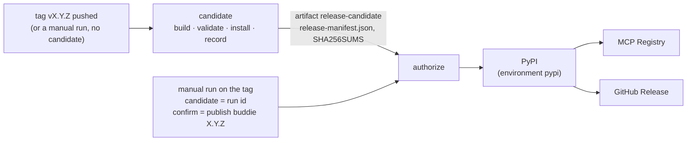

# Releasing buddie

A release is two runs of [`release.yml`](../.github/workflows/release.yml): a **candidate** built and checked from
one commit, then a **publish** run that a person starts on purpose and that sends those same files out. Pushing a
tag publishes nothing.



## 1. The candidate

[`release-candidate.yml`](../.github/workflows/release-candidate.yml) runs for a pushed tag `v*`, for a manual run of
`release.yml` with an empty `candidate`, and for **every pull request** (from `ci.yml`), so the path is exercised
long before a release needs it. With read-only permission and no secret, it:

1. checks that `buddie.__version__`, `server.json`, `manifest.json` and both plugin manifests agree, and that a tag,
   if there is one, is `v` + that version;
2. builds the sdist and the wheel once (`python -m build`), runs `twine check --strict` and checks that the wheel
   carries no top-level module but `buddie`;
3. validates and packs the Claude Desktop bundle (`@anthropic-ai/mcpb@2.1.2`), unpacks it, checks that it carries no
   tests, research, docs, hooks or skills, and starts its server the way Claude Desktop does
   ([`scripts/smoke_mcpb.py`](../scripts/smoke_mcpb.py));
4. installs the wheel and the sdist each into a clean venv and runs them from outside the checkout
   ([`scripts/smoke_install.py`](../scripts/smoke_install.py)): both entry points report the version, the stdio MCP
   server lists its four tools, and the README's quickstart gives exit 1 and `FAIL`;
5. records the candidate ([`scripts/release_manifest.py`](../scripts/release_manifest.py)): `release-manifest.json`
   (schema `buddie-release-candidate-v1`: version, commit, ref, repository, run id, and each file's path, kind,
   size and SHA-256) and `SHA256SUMS` in the format `sha256sum -c` reads; both are checked against the files at once;
6. uploads `dist/`, `bundle/`, the record and the sums as the artifact `release-candidate`, and writes the sums and
   the record into the run's summary.

The same check runs on a machine of your own without GitHub:

```bash
python -m build --outdir rc/dist
```

```bash
npx --yes @anthropic-ai/mcpb@2.1.2 pack . rc/bundle/buddie-2.0.0.mcpb
```

```bash
python scripts/release_manifest.py write rc --version 2.0.0 --commit "$(git rev-parse HEAD)"
```

```bash
cd rc && sha256sum -c SHA256SUMS
```

## 2. Publishing

Only a manual run publishes: Actions → **release** → *Run workflow*, **on the tag** `vX.Y.Z` (not a branch), with

| Input | Value |
|---|---|
| `candidate` | the run id of the candidate run for this tag (the number in its URL) |
| `confirm` | exactly `publish buddie X.Y.Z` |
| `only` | `all` (or one stage again, below) |

or from a terminal:

```bash
gh workflow run release.yml --repo tsyyan/buddie --ref vX.Y.Z -f candidate=RUN_ID -f confirm="publish buddie X.Y.Z"
```

**`authorize`** refuses the run unless: it runs on a tag; the tag is `v` + `buddie.__version__`; `confirm` is the
exact sentence; the tag's commit is on `main`; the candidate run is a run of `release.yml` in this repository that
succeeded and built this same commit; and the downloaded files, the record and the sums agree byte for byte. A
typo, a tag on an unmerged commit, a candidate from another commit, a rebuilt file: each stops here, before anything
leaves.

Then each stage downloads the **candidate's artifact** (never a new build) and checks it again:

| Stage | What it publishes | How | Checked after |
|---|---|---|---|
| `pypi` | the wheel and the sdist (not the bundle) | trusted publishing from environment `pypi`: GitHub's OIDC token, no PyPI token stored | PyPI's JSON API serves exactly the candidate's two files, by SHA-256 |
| `mcp-registry` | `server.json` as `io.github.tsyyan/buddie` | `mcp-publisher` v1.8.1, its download checked against its release's SHA-256; GitHub OIDC proves the namespace | the registry answers for the version |
| `github-release` | a release with the CHANGELOG section `## buddie X.Y.Z`, the three files, `release-manifest.json` and `SHA256SUMS` | created as a draft, files uploaded, each asset's digest compared with the record, then published | every asset is the candidate's |

The registry and the release start only after PyPI succeeded (or, for a stage run alone, after checking that PyPI
already serves the candidate's files): neither announces a version people cannot install.

### When a stage fails

Every stage can run again and only completes what is missing:

| Failure | What is left | Recovery |
|---|---|---|
| `authorize` | nothing published | fix the input (or tag the right commit and build a new candidate), run again |
| `pypi` during upload | maybe one of the two files on PyPI | run again with the same inputs (or *Re-run failed jobs*): `skip-existing` sends what is missing, the check refuses a file on PyPI that is not the candidate's |
| `pypi` check fails on a digest | PyPI holds a different file under that name | stop. A version on PyPI can never be uploaded again; release `X.Y.Z+1` |
| `mcp-registry` | PyPI done | run again with `only: mcp-registry`; a version the registry already lists is skipped |
| `github-release` | PyPI done; maybe a draft release | run again with `only: github-release`; it finds the draft, uploads the missing files, refuses a file whose digest differs, then publishes |
| the candidate's artifact expired (90 days) | nothing published | build a new candidate (manual run on the tag, empty `candidate`) and publish that run |

## One-time setup (the repository owner)

Already done for 1.x: the PyPI trusted publisher for `tsyyan/buddie`, workflow `release.yml`, environment `pypi`.
The workflow keeps both names, so it still matches.

Recommended, and **not** done by this repository (they are settings only the owner can change):

- **A required reviewer on the `pypi` environment** (Settings → Environments → `pypi` → *Required reviewers*). Today
  the environment has no protection rules, so anyone who can run workflows can start the publish run; `authorize`
  checks what it is asked to publish, not who asks. With a reviewer, the PyPI upload waits for that person's click.
- **A tag ruleset for `v*`** (Settings → Rules → Rulesets) so only the owner can create or move release tags.
- If TestPyPI is wanted again, a trusted publisher there and an environment `testpypi`; the workflow no longer has
  that target, since the candidate replaces it as the dry run.

## Cutting a release

1. Bump the version in `buddie/__init__.py`, `pyproject.toml`, `CITATION.cff`, `.claude-plugin/plugin.json`,
   `.codex-plugin/plugin.json`, `manifest.json`, `server.json` (both fields), `integrations/chatgpt/plugin.json` and
   the pinned `pip install buddie==…` in `skills/verbatim/SKILL.md` (`tests/test_version.py`,
   `tests/test_manifest.py` and `tests/test_catalog.py` fail until they agree). `plugin.json`'s version is what moves
   installed plugin users to the release.
2. Give the `CHANGELOG.md` section its date: `## buddie X.Y.Z (YYYY-MM-DD)`; the same date in `CITATION.cff`; the
   README's "Status" says the version is released (the README is also PyPI's page for it).
3. Merge to `main` with CI green (CI has already built a candidate of that commit).
4. Tag the merge commit and push the tag: the candidate run starts.

   ```bash
   git tag vX.Y.Z
   ```

   ```bash
   git push origin vX.Y.Z
   ```

5. Read the candidate run's summary: the commit, the sums. Download the artifact if you want to try it by hand.
6. Start the publish run (above) with that run's id.
7. After it: the steps outside this repository ([distribution.md](distribution.md)).

## Installing from PyPI

```bash
pip install buddie
```

Without touching the current environment:

```bash
pipx install buddie
```

```bash
uvx buddie verify report.md
```

The MCP server for clients that start a command: `uvx buddie serve` (stdio). The package installs one module,
`buddie`, and two commands, `buddie` and `buddie-verbatim`. To check a downloaded file against a release:
`sha256sum -c SHA256SUMS` next to the files from the GitHub Release.
