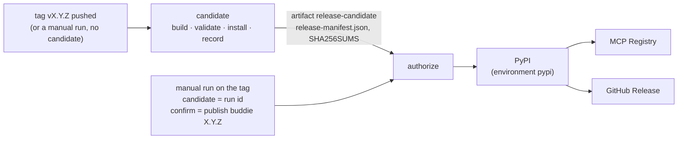

# Releasing buddie

A release is two runs of [`release.yml`](../.github/workflows/release.yml): a **candidate** built and checked from
one commit, then a **publish** run that a person starts on purpose and that sends those same files out. Pushing a
tag publishes nothing.



## 1. The candidate

[`release-candidate.yml`](../.github/workflows/release-candidate.yml) runs for a pushed tag `v*`, for a manual run of
`release.yml` with an empty `candidate`, and for **every pull request** (from `ci.yml`), so the path is exercised
long before a release needs it. With read-only permission and no secret, it:

1. checks that `buddie.__version__`, `server.json`, `manifest.json` and both plugin manifests agree, and that a tag,
   if there is one, is `v` + that version;
2. builds the sdist and the wheel once (`python -m build`), runs `twine check --strict` and checks that the wheel
   carries no top-level module but `buddie`;
3. validates and packs the Claude Desktop bundle (`@anthropic-ai/mcpb@2.1.2`), unpacks it, checks that it carries no
   tests, research, docs, hooks or skills, and starts its server the way Claude Desktop does
   ([`scripts/smoke_mcpb.py`](../scripts/smoke_mcpb.py));
4. installs the wheel and the sdist each into a clean venv and runs them from outside the checkout
   ([`scripts/smoke_install.py`](../scripts/smoke_install.py)): both entry points report the version, the stdio MCP
   server lists its four tools, and the README's quickstart gives exit 1 and `FAIL`;
5. records the candidate ([`scripts/release_manifest.py`](../scripts/release_manifest.py)): `release-manifest.json`
   (schema `buddie-release-candidate-v1`: version, commit, ref, repository, run id, and each file's path, kind,
   size and SHA-256) and `SHA256SUMS` in the format `sha256sum -c` reads; both are checked against the files at once;
6. uploads `dist/`, `bundle/`, the record and the sums as the artifact `release-candidate`, and writes the sums and
   the record into the run's summary.

The same check runs on a machine of your own without GitHub:

```bash
python -m build --outdir rc/dist
```

```bash
npx --yes @anthropic-ai/mcpb@2.1.2 pack . rc/bundle/buddie-2.0.0.mcpb
```

```bash
python scripts/release_manifest.py write rc --version 2.0.0 --commit "$(git rev-parse HEAD)"
```

```bash
cd rc && sha256sum -c SHA256SUMS
```

## 2. Publishing

Only a manual run publishes: Actions → **release** → *Run workflow*, **on the tag** `vX.Y.Z` (not a branch), with

| Input | Value |
|---|---|
| `candidate` | the run id of the candidate run for this tag (the number in its URL) |
| `confirm` | exactly `publish buddie X.Y.Z` |
| `only` | `all` (or one stage again, below) |

or from a terminal:

```bash
gh workflow run release.yml --repo tsyyan/buddie --ref vX.Y.Z -f candidate=RUN_ID -f confirm="publish buddie X.Y.Z"
```

**`authorize`** downloads the candidate and refuses the run unless every one of these holds
([`scripts/release_publish.py`](../scripts/release_publish.py) `authorize`, tested in
[`tests/test_release_publish.py`](../tests/test_release_publish.py)):

- the run is on a tag (not a branch), the tag is `v` + `buddie.__version__`, and the tag names the commit the run
  checked out;
- that commit is in `main`'s history;
- `confirm` is exactly `publish buddie X.Y.Z`;
- the candidate run is a run of `.github/workflows/release.yml` (not CI's), in this repository and built from it, on
  this tag (`head_branch`) and this commit (`head_sha`), triggered by a push or a manual run, `completed` with
  `success`;
- the artifact's own record names that run id, this repository and `refs/tags/vX.Y.Z`, and its files, record and
  sums agree byte for byte.

A typo, a branch, a tag on an unmerged or other commit, a candidate from another commit, workflow or repository, a
failed run, a rebuilt file: each stops here, before anything leaves.

Then each stage downloads the **candidate's artifact** (never a new build) and checks it again:

| Stage | Before | Publishes | How | After | What the check proves |
|---|---|---|---|---|---|
| `pypi` | PyPI's JSON API for the version: absent → upload; exactly the candidate's files → done, no upload; any other file → **stop** | the wheel and the sdist (not the bundle) | trusted publishing from environment `pypi` (GitHub's OIDC token, no PyPI token stored), `skip-existing` | PyPI serves exactly the candidate's two files | **bytes**: PyPI publishes each file's SHA-256 |
| `mcp-registry` | PyPI serves the candidate's files; the registry's entry for the version, if any, must name the same server, version, repository and PyPI package as `server.json`, else **stop** | `server.json` as `io.github.tsyyan/buddie` | `mcp-publisher` v1.8.1, its download checked against its release's SHA-256; GitHub OIDC proves the namespace | the entry matches `server.json` | **metadata only**: the registry stores no digest. It points clients at `buddie==X.Y.Z` on PyPI, whose bytes the `pypi` check covers |
| `github-release` | PyPI serves the candidate's files; the tag names the candidate's commit | a release with the CHANGELOG section, the three files, `release-manifest.json` and `SHA256SUMS` | finds the published release by tag, else the one draft for the tag, else creates a draft; re-reads it by id; uploads only missing files; checks every asset; publishes; reads it back by tag | every asset is the candidate's, by SHA-256 | **bytes**: GitHub's asset `digest`, or the asset downloaded and hashed when GitHub gives none |

The registry and the release start only after PyPI succeeded (or, for a stage run alone, after checking that PyPI
already serves the candidate's files): neither announces a version people cannot install. GitHub's API does not
return a draft by tag, so a draft is found by listing the releases; a listing that missed one would leave two
drafts, and the next run stops on them instead of choosing.

## Partial publication

The three stages are three services. **Publication is not a transaction**: PyPI can have the version while the
registry or the release does not, and nothing is rolled back. A version on PyPI can never be replaced or uploaded
again, even after it is deleted; a wrong one is fixed by releasing `X.Y.Z+1`.

**Which stages completed.** The publish run's job list shows each stage's result. The services themselves:

```bash
curl -s https://pypi.org/pypi/buddie/X.Y.Z/json
```

```bash
curl -s https://registry.modelcontextprotocol.io/v0/servers/io.github.tsyyan%2Fbuddie/versions/X.Y.Z
```

```bash
gh release view vX.Y.Z --repo tsyyan/buddie --json isDraft,assets
```

**Whether what is published is the candidate.** Download the candidate run's artifact and compare: PyPI's
`digests.sha256` per file and each release asset's `digest` with `SHA256SUMS`; the registry entry's name, version
and package with `server.json`. The stages do this themselves before and after they publish.

**Retrying one stage.** The same inputs, with `only`:

```bash
gh workflow run release.yml --repo tsyyan/buddie --ref vX.Y.Z -f candidate=RUN_ID -f confirm="publish buddie X.Y.Z" -f only=mcp-registry
```

(`only=pypi` or `only=github-release` likewise), or *Re-run failed jobs* on the publish run. Each stage completes only
what is missing:

| Situation | The stage | What to do |
|---|---|---|
| `authorize` failed | nothing published | fix the input (or tag the right commit and build a new candidate), run again |
| PyPI holds one of the two files | uploads the other | run `pypi` again |
| PyPI holds exactly the candidate's files | done, no upload | nothing |
| PyPI holds a file that is not the candidate's | **stops** before uploading | stop: PyPI cannot be corrected. Find out how that file got there; release `X.Y.Z+1` |
| PyPI done, the registry failed | the PyPI files stay | run `only=mcp-registry` |
| the registry already lists the version as `server.json` says | skipped | nothing |
| the registry lists the version differently | **stops** | a person compares the entry with `server.json`; the registry does not take a version twice |
| PyPI done, the release failed | the PyPI files stay | run `only=github-release`; it uses the candidate's artifact, no rebuild |
| a draft with some of the files | uploads only the missing ones, then publishes | run `only=github-release` |
| a draft or release with a file that is not the candidate's | **stops**; never replaced | a person looks at that asset and deletes it by hand if it is wrong, then run again |
| an asset whose upload did not finish (state not `uploaded`) | **stops** | delete that asset by hand, run again |
| an asset with no digest that cannot be downloaded | **stops** | it cannot be checked; look at it by hand |
| two drafts for the tag | **stops** | delete the extra draft by hand |
| the release already published with every file | done, unchanged | nothing |
| the release published without some file | **stops**; a published release is not changed | add the file by hand after checking it, or leave it |
| the tag names another commit than the candidate | **stops** before any write | the tag moved: stop and find out why |
| the candidate's artifact expired (90 days) | nothing published | build a new candidate (manual run on the tag, empty `candidate`) and publish that run |

**When to stop and ask.** Every **stop** above is for a person: a file on a service that is not the candidate's, a
tag that moved, a registry entry that disagrees, a half-made asset. None of them is retried into success.

## Before the first release from this workflow (owner)

These are settings and decisions only the repository owner can make. Each line says what was observed on 2026-10-24
through the API, not what is configured by the time of the release.

- [ ] **Required reviewer on the `pypi` environment** (Settings → Environments → `pypi` → *Required reviewers*).
  Observed: `protection_rules: []`, no deployment branch policy. Without it anyone who can run workflows can start
  the publish run; `authorize` checks what is published, not who asks.
- [ ] **Protection for release tags `v*`** (Settings → Rules → Rulesets: restrict creation, update and deletion to
  the owner). Observed: no rulesets.
- [ ] **Trusted publishing on PyPI** matches workflow `release.yml` and environment `pypi` for `tsyyan/buddie`
  (pypi.org → the project → Publishing). Observed only indirectly: the 1.x releases were published under these names
  (run 39439955515). PyPI's settings are not visible from here.
- [ ] **GitHub Actions permissions.** Observed: the default workflow token is read-only and cannot approve pull
  requests. The workflow asks for more per job only: `id-token: write` for `pypi` and `mcp-registry`,
  `contents: write` for `github-release`, `actions: read` to download the candidate.
- [ ] **The release operator**: the person who starts the publish run, and the reviewer on `pypi`, are the people
  the owner intends. Not checkable from the repository.
- [ ] **The approved candidate run id**: the candidate run for the tag, its summary's commit and sums read, before
  it is typed into `candidate`.
- [ ] **No publication on tag creation**: the tag push's run shows only the `candidate` job; the publishing jobs are
  skipped. `tests/test_release_manifest.py` checks the workflow for it; confirm it on the first tag's run.

## One-time setup (the repository owner)

Already done for 1.x: the PyPI trusted publisher for `tsyyan/buddie`, workflow `release.yml`, environment `pypi`.
The workflow keeps both names, so it still matches. If TestPyPI is wanted again, it needs a trusted publisher there
and an environment `testpypi`; the workflow no longer has that target, since the candidate replaces it as the dry
run.

## Cutting a release

1. Bump the version in `buddie/__init__.py`, `pyproject.toml`, `CITATION.cff`, `.claude-plugin/plugin.json`,
   `.codex-plugin/plugin.json`, `manifest.json`, `server.json` (both fields), `integrations/chatgpt/plugin.json` and
   the pinned `pip install buddie==…` in `skills/verbatim/SKILL.md` (`tests/test_version.py`,
   `tests/test_manifest.py` and `tests/test_catalog.py` fail until they agree). `plugin.json`'s version is what moves
   installed plugin users to the release.
2. Give the `CHANGELOG.md` section its date: `## buddie X.Y.Z (YYYY-MM-DD)`; the same date in `CITATION.cff`; the
   README's "Release status" table names it as the latest release (the README is also PyPI's page for it;
   `tests/test_readme.py` fails until the two agree).
3. Merge to `main` with CI green (CI has already built a candidate of that commit).
4. Tag the merge commit and push the tag: the candidate run starts.

   ```bash
   git tag vX.Y.Z
   ```

   ```bash
   git push origin vX.Y.Z
   ```

5. Read the candidate run's summary: the commit, the sums. Download the artifact if you want to try it by hand.
6. Go through the checklist above, then start the publish run with that run's id.
7. After it: the steps outside this repository ([distribution.md](distribution.md)).

## Installing from PyPI

```bash
pip install buddie
```

Without touching the current environment:

```bash
pipx install buddie
```

```bash
uvx buddie verify report.md
```

The MCP server for clients that start a command: `uvx buddie serve` (stdio). The package installs one module,
`buddie`, and two commands, `buddie` and `buddie-verbatim`. To check a downloaded file against a release:
`sha256sum -c SHA256SUMS` next to the files from the GitHub Release.
